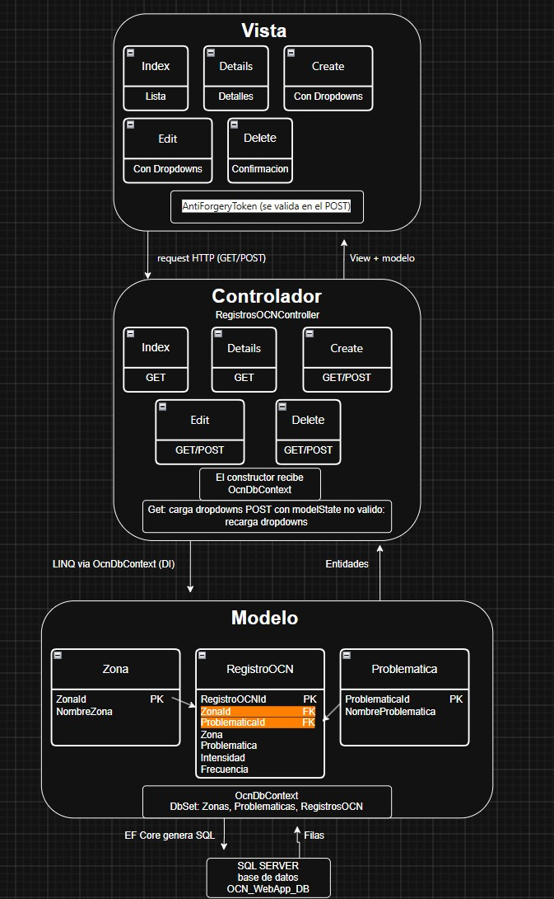

# OCN WebApp — Módulo RegistrosOCN

WebApp **ASP.NET Core MVC** para capturar y administrar los registros de detección (**RegistrosOCN**) del Observatorio Comunitario de Necesidades (OCN), conectada a **SQL Server** con **Entity Framework Core**.

**Actividad 8: WebApp MVC (Requerimiento Integrador)**
Bases de Datos Avanzadas · Unidad III · Universidad de Montemorelos, Facultad de Ingeniería y Tecnología · Noviembre 2026

## Autores
- Daniel Saith García López
- Hemerson David Camelo Hernández

## Qué incluye
- **CRUD completo** de RegistrosOCN: Index, Details, Create, Edit y Delete.
- **Llaves foráneas** hacia `Zona` y `Problematica`, con propiedades de navegación.
- **Dropdowns** para elegir la zona y la problemática en Create y Edit.
- **Validaciones:** `[Range(1,5)]` en Intensidad y Frecuencia y `[Required]` en las llaves foráneas.
- **AntiForgeryToken** en los 3 formularios de escritura (Create, Edit y Delete).
- Datos anónimos: no se guardan datos personales identificables.

## Estructura
| Carpeta | Contenido |
|---|---|
| `OCN_WebApp/Models` | `Zona`, `Problematica`, `RegistroOCN` |
| `OCN_WebApp/Data` | `OcnDbContext` |
| `OCN_WebApp/Controllers` | `RegistrosOCNController` (5 acciones CRUD) |
| `OCN_WebApp/Views/RegistrosOCN` | Las 5 vistas Razor |
| `OCN_WebApp/Migrations` | Migración `InitialCreate` |
| `Scripts` | `01_CreacionBD_Migracion.sql` y `02_DatosSemilla.sql` |
| `Docs` | Diagrama MVC de RegistrosOCN |
| `GUIA_DESPLIEGUE.md` | Guía de despliegue y checklist de verificación |

## Diagrama MVC


## Cómo ejecutarlo
Requisitos: .NET SDK 11 y SQL Server (instancia local, autenticación de Windows).

```bash
# 1. Crear la base de datos con la migración
cd OCN_WebApp
dotnet ef database update

# 2. Cargar los datos semilla: ejecutar Scripts/02_DatosSemilla.sql en SSMS

# 3. Ejecutar la app y abrir /RegistrosOCN
dotnet run
```

La cadena de conexión está en `OCN_WebApp/appsettings.json` (`OcnConnection`, base `OCN_WebApp_DB`). Los pasos completos, incluida la publicación local, están en [GUIA_DESPLIEGUE.md](GUIA_DESPLIEGUE.md).
